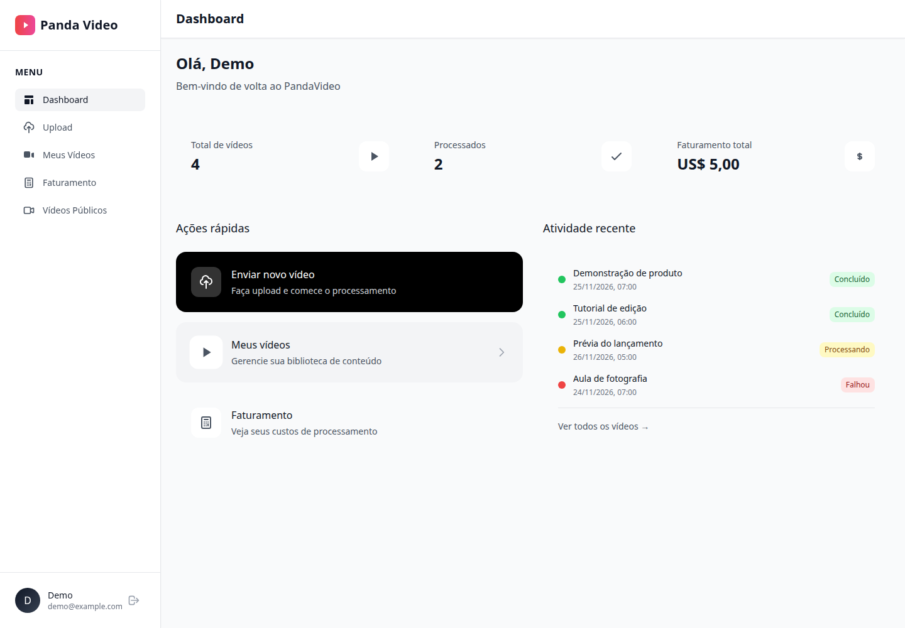
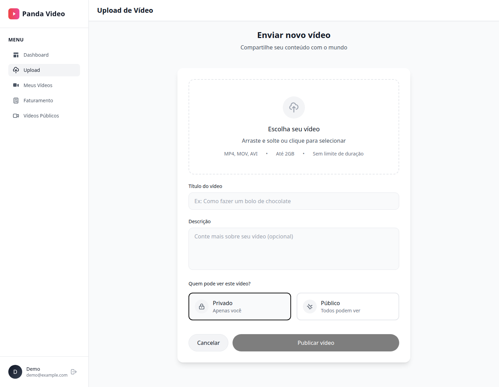

# Panda Video Frontend

Interface web moderna para o sistema de hospedagem e processamento de vídeos Panda Video, construída com Vue 3, Tailwind CSS e Vite.

## 🚀 Características

- **Interface Moderna**: Design responsivo e intuitivo com Tailwind CSS
- **Vue 3 + Composition API**: Framework reativo e performático
- **Gerenciamento de Estado**: Pinia para estado global
- **Autenticação JWT**: Sistema seguro de login e proteção de rotas
- **Upload de Vídeos**: Interface drag-and-drop com progresso em tempo real
- **Player HLS**: Reprodução de vídeos processados
- **Dashboard**: Visualização de estatísticas e métricas
- **Responsivo**: Funciona perfeitamente em desktop e mobile

## Capturas da interface

Frontend Vue real, compilado e executado localmente com respostas de API
simuladas no navegador. Conta, vídeos, métricas e faturamento são dados de
exemplo, não dados de produção. Nenhum vídeo foi enviado ou processado e
nenhuma cobrança foi realizada durante a captura.





## 📋 Pré-requisitos

- Node.js 18+
- Docker e Docker Compose (para containerização)
- Backend Panda Video rodando

## 🛠️ Instalação e Execução

### Desenvolvimento Local

1. **Clone e instale dependências:**
```bash
cd panda-video-frontend
npm install
```

2. **Configure as variáveis de ambiente:**
```bash
cp .env.example .env
# Edite o .env conforme necessário
```

3. **Inicie o servidor de desenvolvimento:**
```bash
npm run dev
```

4. **Acesse a aplicação:**
   - Frontend: `http://localhost:8080`
   - API Backend: `http://localhost:3000`

### Com Docker (Recomendado)

1. **Build e execute tudo:**
```bash
docker-compose up --build
```

2. **Acesse a aplicação:**
   - Frontend: `http://localhost:8080`
   - Backend: `http://localhost:3000`

## 📚 Estrutura do Projeto

```
src/
├── assets/          # Estilos globais e recursos
├── components/      # Componentes reutilizáveis
│   └── TheHeader.vue
├── router/          # Configuração de rotas
├── services/        # Integração com API
│   └── api.js
├── stores/          # Gerenciamento de estado (Pinia)
│   ├── auth.js
│   ├── videos.js
│   └── billing.js
├── utils/           # Utilitários e helpers
├── views/           # Páginas da aplicação
│   ├── LoginView.vue
│   ├── DashboardView.vue
│   ├── VideosView.vue
│   ├── VideoDetailsView.vue
│   ├── UploadView.vue
│   └── BillingView.vue
├── App.vue          # Componente raiz
└── main.js          # Ponto de entrada
```

## 🔐 Autenticação

### Credenciais de Teste
```
Usuário: testuser
Senha: password
```

### Fluxo de Autenticação
1. Login na página `/login`
2. Token JWT armazenado no localStorage
3. Rotas protegidas verificam autenticação
4. Logout limpa dados e redireciona

## 📱 Páginas e Funcionalidades

### 🏠 Dashboard (`/`)
- Visão geral do sistema
- Cards com estatísticas principais
- Ações rápidas (upload, visualizar vídeos)
- Lista de vídeos recentes

### 📹 Vídeos (`/videos`)
- Lista paginada de todos os vídeos
- Filtros por status (processando, concluído, falhou)
- Auto-refresh para acompanhar processamento
- Cards visuais com preview e informações

### ⬆️ Upload (`/upload`)
- Interface drag-and-drop
- Validação de tipos de arquivo
- Barra de progresso em tempo real
- Formulário com título e descrição
- Diretrizes de upload

### 🎬 Detalhes do Vídeo (`/videos/:id`)
- Player HLS para vídeos processados
- Informações detalhadas do vídeo
- Status de processamento em tempo real
- URL de streaming para integração
- Cálculo de custos

### 💰 Faturamento (`/billing`)
- Total acumulado de cobranças
- Detalhamento por status de vídeo
- Estatísticas de uso
- Histórico de processamento
- Informações de preços

## 🔧 Configuração da API

### Variáveis de Ambiente

```bash
# .env
VITE_API_URL=http://localhost:3000/api
NODE_ENV=development
```

### Integração com Backend

O frontend se conecta automaticamente com a API backend através do Axios:

```javascript
// Configuração automática em src/services/api.js
const API_BASE_URL = import.meta.env.VITE_API_URL || 'http://localhost:3000/api'
```

## 🎨 Design System

### Cores Principais
- **Primary**: Azul (`#3b82f6`, `#2563eb`, `#1d4ed8`)
- **Secondary**: Cinza (`#6b7280`, `#4b5563`, `#374151`)
- **Success**: Verde (`#10b981`)
- **Warning**: Amarelo (`#f59e0b`)
- **Error**: Vermelho (`#ef4444`)

### Componentes CSS Utilitários
```css
.btn-primary      # Botão principal
.btn-secondary    # Botão secundário
.input-field      # Campo de entrada
.card            # Container com sombra
```

### Responsividade
- **Mobile-first**: Design otimizado para mobile
- **Breakpoints**: sm (640px), md (768px), lg (1024px), xl (1280px)
- **Grid flexível**: Layout adaptativo automático

## 🧪 Scripts Disponíveis

```bash
# Desenvolvimento
npm run dev          # Servidor de desenvolvimento

# Build
npm run build        # Build para produção
npm run preview      # Preview do build

# Docker
docker-compose up    # Executar com Docker
```

## 🔄 Estados de Vídeo

O frontend trata diferentes estados de processamento:

| Estado | Descrição | UI |
|--------|-----------|-----|
| `uploading` | Upload em progresso | Loading azul |
| `processing` | Convertendo para HLS | Loading amarelo |
| `completed` | Pronto para reprodução | Ícone verde + Player |
| `failed` | Erro no processamento | Ícone vermelho |

## 📺 Reprodução de Vídeos

### Suporte HLS
- **Navegadores modernos**: Player HTML5 nativo
- **HLS.js**: Fallback para browsers sem suporte nativo
- **Formato**: Playlist `.m3u8` com segmentos `.ts`

### URL de Streaming
```
http://localhost:3000/processed/{video_id}/playlist.m3u8
```

## 🔒 Segurança

### Headers de Segurança (Nginx)
- `X-Frame-Options: SAMEORIGIN`
- `X-Content-Type-Options: nosniff`
- `X-XSS-Protection: 1; mode=block`
- `Referrer-Policy: strict-origin-when-cross-origin`

### Autenticação
- **JWT Bearer Token**: Enviado em todas as requisições
- **Auto-redirect**: Logout automático em caso de token expirado
- **Route Guards**: Proteção de rotas sensíveis

## 📊 Performance

### Otimizações
- **Code Splitting**: Carregamento sob demanda
- **Tree Shaking**: Remoção de código não utilizado
- **Asset Compression**: Gzip automático
- **Cache Strategy**: Headers de cache para assets
- **Lazy Loading**: Componentes carregados quando necessário

### Métricas de Cache
- **Assets estáticos**: Cache de 1 ano
- **API responses**: Cache do navegador gerenciado
- **Images/Videos**: Cache agressivo

## 🐳 Docker

### Dockerfile Multi-stage
```dockerfile
# Build stage
FROM node:18-alpine AS builder
WORKDIR /app
COPY package*.json ./
RUN npm ci
COPY . .
RUN npm run build

# Production stage
FROM nginx:alpine
COPY --from=builder /app/dist /usr/share/nginx/html
COPY nginx.conf /etc/nginx/conf.d/default.conf
EXPOSE 80
```

### Docker Compose
O `docker-compose.yml` inclui:
- **Frontend**: Nginx + Vue build
- **Backend**: API Node.js
- **PostgreSQL**: Banco de dados
- **Redis**: Cache
- **Volumes**: Persistência de dados

## 🔧 Desenvolvimento

### Adicionando Novas Páginas

1. **Criar a view:**
```bash
touch src/views/NovaView.vue
```

2. **Adicionar rota:**
```javascript
// src/router/index.js
{
  path: '/nova',
  name: 'Nova',
  component: () => import('@/views/NovaView.vue'),
  meta: { requiresAuth: true }
}
```

3. **Adicionar ao menu:**
```vue
<!-- src/components/TheHeader.vue -->
<router-link to="/nova">Nova Página</router-link>
```

### Integrando com Nova API

1. **Criar store:**
```javascript
// src/stores/novaFeature.js
import { defineStore } from 'pinia'
import api from '@/services/api'

export const useNovaFeatureStore = defineStore('novaFeature', {
  state: () => ({
    data: [],
    loading: false,
    error: null
  }),
  
  actions: {
    async fetchData() {
      this.loading = true
      try {
        const response = await api.get('/nova-feature')
        this.data = response.data
      } catch (error) {
        this.error = error.response?.data?.error
      } finally {
        this.loading = false
      }
    }
  }
})
```

2. **Usar na view:**
```vue
<script setup>
import { onMounted } from 'vue'
import { useNovaFeatureStore } from '@/stores/novaFeature'

const store = useNovaFeatureStore()

onMounted(() => {
  store.fetchData()
})
</script>
```

## 🐛 Troubleshooting

### Problemas Comuns

**Frontend não conecta com backend:**
```bash
# Verificar se o backend está rodando
curl http://localhost:3000/health

# Verificar variável de ambiente
echo $VITE_API_URL
```

**Vídeos não carregam:**
- Verificar se o processamento HLS foi concluído
- Confirmar que os arquivos estão no diretório `/processed`
- Testar URL diretamente no navegador

**Build falha:**
```bash
# Limpar cache e reinstalar
rm -rf node_modules package-lock.json
npm install
npm run build
```

**Docker não inicia:**
```bash
# Verificar logs
docker-compose logs frontend
docker-compose logs backend

# Rebuild sem cache
docker-compose build --no-cache
```

## 🤝 Contribuição

1. Fork o projeto
2. Crie uma branch para sua feature (`git checkout -b feature/AmazingFeature`)
3. Commit suas mudanças (`git commit -m 'Add some AmazingFeature'`)
4. Push para a branch (`git push origin feature/AmazingFeature`)
5. Abra um Pull Request

## 📄 Licença

Este projeto está sob a licença MIT. Veja o arquivo `LICENSE` para mais detalhes.

## 📞 Suporte

Para dúvidas ou problemas:
- Abra uma issue no repositório
- Verifique a documentação da API backend
- Consulte os logs do Docker Compose

---

**Sistema completo funcionando!** 🎉

Frontend moderno integrado com API robusta para hospedagem e processamento de vídeos.